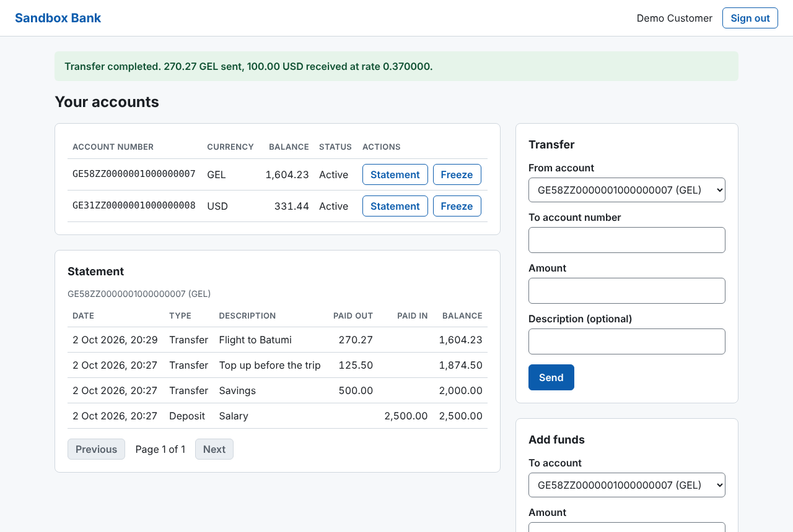
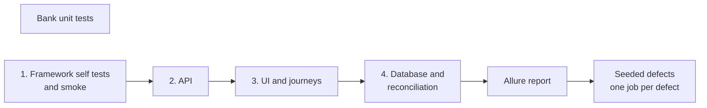
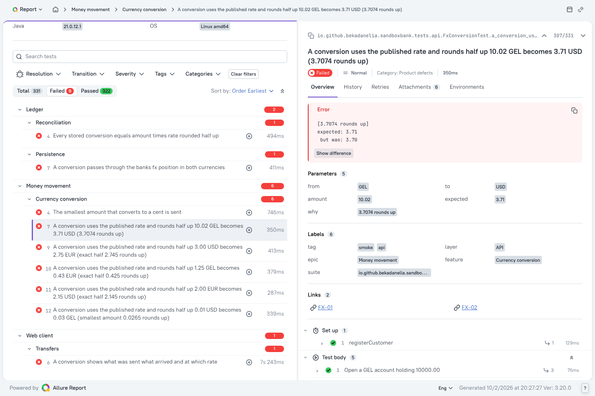

# Sandbox Bank QA

[](https://github.com/bekadanelia/bank-sandbox-qa/actions/workflows/ci.yml)
[](LICENSE)

A test automation project around a small banking system that lives in the same repository:
a REST API, a PostgreSQL double entry ledger and a web client.

* **331 automated tests** on four layers: API, database, UI and end to end. They run in parallel in about a minute.
* **Every API response is checked against the OpenAPI contract**, in every test, by one filter.
* **The books are reconciled in SQL.** Twelve queries prove that no money was created, lost or counted twice.
* **Nine defects can be switched on in the bank.** The pipeline proves that the suite catches each one.
* No retries, no sleeps, no shared test data.



## Contents

* [What is tested](#what-is-tested)
* [Would these tests notice a bug?](#would-these-tests-notice-a-bug)
* [A defect the suite found on its own](#a-defect-the-suite-found-on-its-own)
* [Three tests worth reading](#three-tests-worth-reading)
* [Run it](#run-it)
* [The pipeline](#the-pipeline)
* [The report](#the-report)
* [Repository layout](#repository-layout)
* [Documents](#documents)
* [Limits](#limits)

## What is tested

Sandbox Bank lets customers register, open accounts in GEL, USD and EUR, pay cash in and transfer
money, with currency conversion and a ledger behind it. Its 54 business rules are listed in
[docs/requirements.md](docs/requirements.md).

The bank is part of this repository on purpose. A public demo site cannot be reset, has no
database to look into and changes without notice. A system under full control makes every layer
testable and makes it possible to ask the question in the next section.

| Layer | Tools | What it proves | Tests |
|-------|-------|----------------|------:|
| API | REST Assured, JSON Schema | Business rules at their boundaries, validation, access control, idempotency, race conditions | 238 |
| Database | JDBC, SQL | Ledger invariants, what the API stores, constraints as the last line of defence | 33 |
| UI | Playwright, axe | What the customer sees after each action, error messages, double clicks, accessibility | 37 |
| End to end | all of the above | Two journeys from the browser through the API into the ledger | 2 |
| Framework | JUnit | The contract checker, the oracles and the traceability of rules to tests | 21 |

The bank itself has 34 unit tests for its money arithmetic.

Every rule is tested at the lowest layer that can prove it. The reasoning is in
[docs/test-strategy.md](docs/test-strategy.md).

## Would these tests notice a bug?

A green run says that nothing the tests look at is broken. It does not say how much they look at.
So the bank can be started with a realistic defect switched on, and the suite has to fail in the
right place.

```
SANDBOX_FAULTS=FX_TRUNCATE docker compose up -d --build --wait
```

| Defect | What the bank does wrong | API | DB | UI |
|--------|--------------------------|:---:|:--:|:--:|
| `FX_TRUNCATE` | Cuts converted amounts off instead of rounding half up | ✔ | ✔ | ✔ |
| `LIMIT_OFF_BY_ONE` | Rejects a transfer of exactly the limit | ✔ | | |
| `IDEMPOTENCY_IGNORED` | Executes a repeated request a second time | ✔ | ✔ | ✔ |
| `NO_ROW_LOCK` | Lets parallel transfers overwrite each other's balance | ✔ | ✔ | |
| `DEADLOCK_PRONE_LOCK` | Deadlocks parallel deposits | ✔ | | |
| `FX_POSITION_SKIPPED` | Leaves the bank's side of a conversion out of the ledger | | ✔ | |
| `IDOR_ACCOUNT_READ` | Lets any customer read any account | ✔ | | |
| `STATEMENT_ORDER` | Returns statements oldest first | ✔ | | ✔ |
| `UI_STALE_BALANCE` | Shows the old balance after a transfer | | | ✔ |

The table also shows why there are three layers. With `FX_POSITION_SKIPPED` every API and UI test
passes, because the customer's balances are right. Only the SQL reconciliation sees that the bank's
own books no longer add up. `UI_STALE_BALANCE` is the opposite case.

The pipeline runs this check for all nine defects after the healthy run.
Details: [docs/seeded-defects.md](docs/seeded-defects.md).

## A defect the suite found on its own

The first parallel run of the suite failed once with an answer the contract does not document:

```
ContractViolation: POST /accounts/{accountId}/deposits answered 500,
which openapi.yaml does not document. Documented: [201, 400, 401, 404, 409, 415, 422]
```

The bank log said `deadlock detected`. Every deposit inserts a transfer row, which makes
PostgreSQL take a key share lock on the bank's cash account, and then asked for `FOR UPDATE` on
the same row. Two deposits at the same moment waited for each other. The fix is one lock mode,
`FOR NO KEY UPDATE`. The old behaviour stayed in the bank as the seeded defect
`DEADLOCK_PRONE_LOCK`, so the regression test is proven to catch it.

This and three more findings are written up as [defect reports](docs/defect-reports.md).

## Three tests worth reading

**A boundary, tested on both sides and exactly on it.**
[TransferRulesTest](tests/src/test/java/io/github/bekadanelia/sandboxbank/tests/api/TransferRulesTest.java)

```java
@ParameterizedTest(name = "{0} is within the limit")
@ValueSource(strings = {"9999.99", "10000.00"})
void amounts_up_to_the_limit_are_sent(String amount) {
    Account source = customer.accountWithBalance(Currency.GEL, "20000.00");
    Account target = customer.openAccount(Currency.GEL);

    customer.sendTransfer(source, target, amount)
            .then().statusCode(201);

    assertThat(customer.balanceOf(target)).isEqualByComparingTo(amount);
}
```

**A ledger rule as a query that selects its violations.**
[balances_match_ledger.sql](tests/src/main/resources/sql/invariants/balances_match_ledger.sql)

```sql
-- LED-02 Reconciliation: the stored balance of an account equals its credits minus its debits.
-- A lost update under concurrency shows up here.
SELECT a.number,
       a.kind,
       a.currency,
       a.balance AS stored_balance,
       coalesce(sum(CASE e.direction WHEN 'CREDIT' THEN e.amount ELSE -e.amount END), 0) AS ledger_balance
FROM accounts a
         LEFT JOIN ledger_entries e ON e.account_id = a.id
GROUP BY a.id
HAVING a.balance <> coalesce(sum(CASE e.direction WHEN 'CREDIT' THEN e.amount ELSE -e.amount END), 0)
ORDER BY a.number
```

**The worst moment for a payment to fail.** The bank has moved the money, the answer is lost on
the way back, and the customer presses Send again.
[TransferUiTest](tests/src/test/java/io/github/bekadanelia/sandboxbank/tests/ui/TransferUiTest.java)

```java
page.route(TRANSFERS_ENDPOINT, route -> {
    route.fetch();     // the bank executes the transfer
    route.abort();     // the browser never hears about it
}, new Page.RouteOptions().setTimes(1));

form.fill(source, target.number(), "60.00").send();
assertThat(dashboard.alert()).containsText("The bank did not confirm the result.");
form.send();

assertThat(dashboard.notice()).hasText("Transfer completed. 60.00 GEL sent.");
assertThat(dashboard.account(source).balance()).hasText("190.00");   // 250.00 minus 60.00, once
```

## Run it

You need Docker, JDK 21 and Maven 3.9.

```
git clone https://github.com/bekadanelia/bank-sandbox-qa.git
cd bank-sandbox-qa

docker compose up -d --build --wait      # the bank on http://localhost:8080
mvn -f tests/pom.xml test                # every suite
mvn -f tests/pom.xml allure:serve        # build the report and open it
```

The first UI run downloads Chromium.

| Command | Runs |
|---------|------|
| `mvn -f tests/pom.xml test -Dgroups=smoke` | The smoke tests, a few seconds |
| `mvn -f tests/pom.xml test -Dgroups="api \| db"` | Everything that needs no browser |
| `mvn -f tests/pom.xml test -Dgroups="ui \| e2e"` | Browser tests |
| `mvn -f tests/pom.xml test -Dtest=FxConversionTest` | One class |
| `mvn -f tests/pom.xml test -Dgroups=ui -Dheadless=false -Dslow.motion.ms=300` | Browser tests you can watch |
| `mvn -f tests/pom.xml test -Dgroups=ui -Dbrowser=firefox` | Another browser |
| `scripts/seeded-defects.sh check-all` | The seeded defect check, about ten minutes |

In PowerShell put each `-D` argument in quotes, for example `"-Dbase.url=http://localhost:8081"`, because PowerShell splits unquoted arguments at the dot.

Every setting in [config.properties](tests/src/main/resources/config.properties) can be overridden
with `-Dkey=value` or an environment variable. If port 8080 or 5432 is taken, start the bank with
`BANK_PORT=8081 DB_PORT=5433 docker compose up -d --build --wait` and pass
`-Dbase.url=http://localhost:8081 -Ddb.url=jdbc:postgresql://localhost:5433/sandbox_bank`.

To explore the bank by hand, sign in at http://localhost:8080 as `demo@sandbox.bank` with the
password `Sandbox#2026`. The API reference is at http://localhost:8080/docs/.

## The pipeline

[.github/workflows/ci.yml](.github/workflows/ci.yml) runs on every push and pull request and once a night.



* The stages go from fast and decisive to slow. A red smoke stage stops the job. After that every stage runs, so one report shows everything that is broken.
* The database stage comes last on purpose. Its reconciliation queries then judge every row the earlier stages wrote.
* The report, Playwright traces of failed UI tests and the bank log are kept as build artifacts.
* The seeded defect matrix runs after a green suite, outside pull requests.

To publish the report with GitHub Pages, choose "GitHub Actions" as the source under
Settings, Pages, and add a repository variable `PUBLISH_REPORT` with the value `true`.

## The report

Allure shows each test with its steps, the HTTP exchange of every API call, the SQL of every
reconciliation check and, for a failed UI test, a screenshot and a Playwright trace. Each test
links to the business rules it verifies.



## Repository layout

```
sut/                     the bank: API, web client, migrations, OpenAPI contract
tests/                   the Maven project
  src/main/java/         framework: API client, page objects, database access, JUnit extensions
  src/main/resources/    configuration and the SQL of the ledger invariants
  src/test/java/         the tests, one package per layer
scripts/                 the seeded defect check and its manifest
docs/                    strategy, rules, decisions, defect reports
.github/workflows/       the pipeline
docker-compose.yml       the bank and its database
```

## Documents

| Document | Content |
|----------|---------|
| [Test strategy](docs/test-strategy.md) | Risks, levels, design techniques, quality gates, what is out of scope |
| [Business rules](docs/requirements.md) | The 54 rules with their ids |
| [Traceability matrix](docs/traceability.md) | Which tests verify which rule, generated from the code |
| [Architecture and decisions](docs/architecture.md) | How the framework is built and why |
| [Seeded defects](docs/seeded-defects.md) | How the suite is tested |
| [Defect reports](docs/defect-reports.md) | Four real findings, written up as for a tracker |

## Limits

This is a sandbox, and some things are deliberately not here: load tests, security scanning,
a browser matrix in the pipeline and manual screen reader sessions. The bank has no lockout
after failed logins, which is recorded as a known product risk. Each gap and what would close it
is listed at the end of the [test strategy](docs/test-strategy.md).
