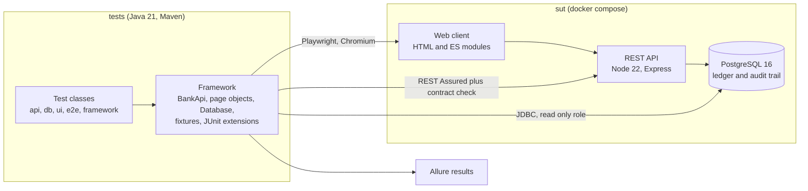
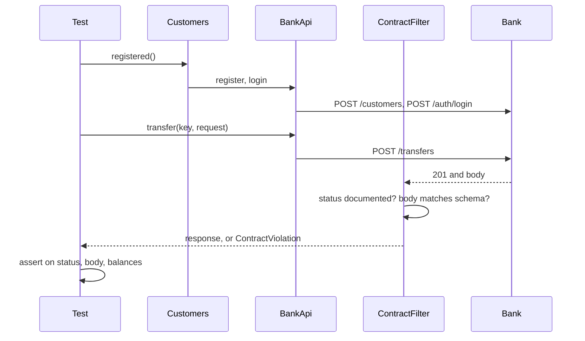

# Architecture and decisions

## The whole picture



The tests know the bank only through its three public faces: the browser, the HTTP API and SQL.
They never import code from `sut/`.

## The test project

```
tests/
  pom.xml
  allurerc.mjs                      settings of the Allure report
  src/main/java/.../sandboxbank/    the framework
    config/      TestConfig          one place for URLs, credentials, browser settings
    api/         BankApi             one method per endpoint, returns the raw response
    api/model/                       request and response records
    api/contract/                    OpenApiContract and the REST Assured filter that applies it
    db/          Database            plain JDBC with a read only and an owner connection
                 LedgerInvariant     the reconciliation rules, one SQL file each
    fixtures/    Customers           creates customers and accounts through the API
    junit/                           @ApiTest, @DbTest, @UiTest, @E2eTest, @Smoke, @Requirement
    support/                         Jwt, Iban, Concurrently
    ui/          BrowserExtension    browser lifecycle, evidence on failure
    ui/pages/                        page objects
  src/main/resources/
    config.properties                defaults for a local run
    sql/invariants/*.sql             queries that select rows breaking a ledger rule
  src/test/java/.../tests/
    api/  db/  ui/  e2e/             the suites
    framework/                       tests of the framework itself
```

`src/main` holds the framework and `src/test` holds only tests. A reader who wants to know what
is tested opens `src/test` and finds nothing else there.

## How one API test runs



## Decisions

Each decision names what was chosen, why, and what it costs.

### 1. The project ships its own system under test

Public demo sites cannot be reset, have no database to look into, change without notice and are
shared with strangers. Tests against them prove little and fail for reasons nobody controls. A
bank that lives in the repository makes every layer testable, lets the pipeline start from an
empty database and makes it possible to seed defects.
Cost: the bank had to be written and is itself a source of bugs. That turned out to be useful,
see [defect-reports.md](defect-reports.md).

### 2. Rules are tested through the API, the browser only tests the browser

API tests are fast and precise, so that is where the business rules are verified.
UI tests cover what exists only in the client: rendering after an action, messages, focus,
double clicks, lost answers. They arrange their data through the API and start with a token
already in place, so only the sign in tests type a password.
Cost: a rule that is wrong only in the UI wording of a refusal would need its own UI test.

### 3. Every response is checked against the OpenAPI contract

A REST Assured filter validates each response of each test against `openapi.yaml`: the status
code must be documented and the body must match the schema, with no extra fields. A functional
test that was written to check a balance therefore also fails when the API drifts from its
documentation. OpenAPI 3.1 schemas are JSON Schema 2020-12, so a JSON Schema validator reads
them as they are.
Cost: every status code a test provokes has to be documented, which is the point.

### 4. Ledger rules are SQL files, checked through a read only role

Each reconciliation rule is one query that selects the rows breaking it, so an empty result means
the rule holds. A single statement sees a single snapshot, which makes the checks safe while
other tests move money. The queries run as a database role that cannot write, so a test can never
repair what it is checking. The same files could run as monitors in production.
Cost: the tests know the schema. That coupling is deliberate and limited to the `db` suite.

### 5. Data per test, no cleanup, parallel by default

Tests create their own customers through the API and share nothing, so classes run in parallel
with four threads and the order never matters. There is no cleanup code to maintain because the
database is thrown away with the containers.
Cost: the database grows during a run. For this size that is irrelevant.

### 6. No retries and no sleeps

A failed test is a finding. Retrying it until it passes hides exactly the intermittent defects
that are hardest to find. Waiting is done on conditions, never on time.
Cost: an unstable environment makes the build red. That is information too.

### 7. Seeded defects answer "would these tests notice?"

Line coverage says which code ran, not whether a wrong result would be noticed. The bank can be
started with one of nine realistic defects switched on, and the pipeline requires the tests that
guard the broken rule to fail. See [seeded-defects.md](seeded-defects.md).
Cost: the bank carries a few lines of deliberately wrong code behind a switch that is off by default.

### 8. JUnit Jupiter, REST Assured, Playwright, plain JDBC, Allure

* JUnit Jupiter for its extension model, nested classes and parameterized tests with named cases.
* REST Assured because its given, when, then style keeps the HTTP assertion readable, behind a
  thin client that hides the plumbing.
* Playwright for auto waiting, locators by role and label, request interception and traces.
* Plain JDBC because a handful of queries does not justify a data access library.
* Allure because one report shows steps, HTTP exchanges, SQL and browser evidence together.

### 9. Test methods are named as sentences

`one_cent_more_than_the_balance_is_rejected` reads the same in the code, in the build log and in
the report, and it states the expected behaviour rather than the action.
Cost: underscores in method names are unusual in Java, and a style checker has to be told to allow them in tests.

### 10. Secrets in reports

The Authorization header is masked in the report. Request and response bodies are not, because
every credential in this sandbox is generated for one test and thrown away. Against a shared
environment the bodies of login and registration calls would be masked in the same filter.
